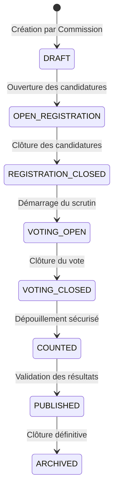
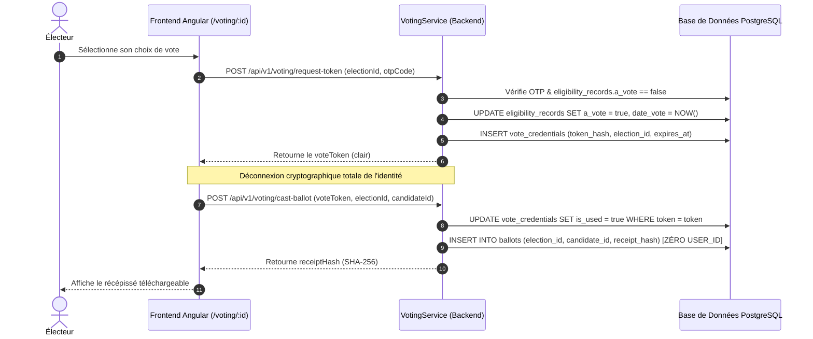
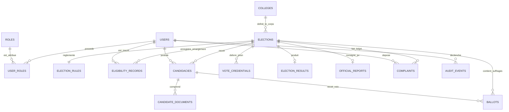

# RAPPORT COMPLET D'AUDIT TECHNIQUE ET FONCTIONNEL DU PROJET VOTE UASZ

---

## RÉSUMÉ EXÉCUTIF

Le projet **Vote UASZ** est une plateforme web intégrée de vote électronique universitaire conçue sur mesure pour l'**Université Assane Seck de Ziguinchor (UASZ)**. Elle vise à dématérialiser, sécuriser, fluidifier et auditer l'ensemble du cycle électoral académique : gestion des collèges électoraux, création des scrutins, appel à candidatures et validation des dossiers, contrôle rigoureux de l'éligibilité, vote secret à double étape avec déconnexion cryptographique, dépouillement en temps réel diffusé par WebSocket, génération de procès-verbaux officiels certifiés en PDF, gestion des recours/contentieux et journal d'audit infalsifiable avec chaînage cryptographique SHA-256.

Le système repose sur une architecture moderne et robuste :
- **Backend** : Spring Boot 3.3.5 / Java 21, Spring Security avec JWT (JJWT 0.12.6), Argon2id (Bouncy Castle), JPA/Hibernate, Flyway, OpenPDF 2.0.3, WebSocket STOMP (Spring Messaging).
- **Frontend** : Angular 21.2.0 (Standalone Components, Signals réactifs, RxJS 7.8, @stomp/stompjs 7.5, Chart.js 4.5.1, Lucide Angular).
- **Base de données** : PostgreSQL 15+ hébergé sur Supabase (profils dev/prod) et H2 en mémoire (profil test).
- **Hébergement & Déploiement** : Frontend déployé sur Vercel, Backend déployé sur Render (service Web Docker / Java).

L'audit approfondi du code source démontre une rigueur exceptionnelle sur le plan cryptographique et réglementaire électoral : **l'anonymat du vote est mathématiquement garanti par découplage strict entre l'identité de l'électeur et son bulletin**, interdisant toute corrélation a posteriori dans la base de données.

---

## TABLE DES MATIÈRES

1. [PARTIE 1 : Présentation générale du projet](#partie-1--présentation-générale-du-projet)
2. [PARTIE 2 : Architecture technique globale](#partie-2--architecture-technique-globale)
3. [PARTIE 3 : Analyse fonctionnelle complète](#partie-3--analyse-fonctionnelle-complète)
4. [PARTIE 4 : Utilisateurs, rôles et matrice des permissions](#partie-4--utilisateurs-rôles-et-matrice-des-permissions)
5. [PARTIE 5 : Base de données et modèle relationnel](#partie-5--base-de-données-et-modèle-relationnel)
6. [PARTIE 6 : Processus métier et parcours utilisateurs](#partie-6--processus-métier-et-parcours-utilisateurs)
7. [PARTIE 7 : Audit de sécurité informatique et matrice des risques](#partie-7--audit-de-sécurité-informatique-et-matrice-des-risques)
8. [PARTIE 8 : Interface et expérience utilisateur (UX/UI)](#partie-8--interface-et-expérience-utilisateur-uxui)
9. [PARTIE 9 : API et logique backend (Catalogue exhaustif)](#partie-9--api-et-logique-backend-catalogue-exhaustif)
10. [PARTIE 10 : Tests, couverture et fiabilité](#partie-10--tests-couverture-et-fiabilité)
11. [PARTIE 11 : État réel d'avancement du projet](#partie-11--état-réel-davancement-du-projet)
12. [PARTIE 12 : Recommandations, feuille de route et axes d'amélioration](#partie-12--recommandations-feuille-de-route-et-axes-damélioration)
13. [PARTIE 13 : Documentation de transmission et consignes pour les futures IA](#partie-13--documentation-de-transmission-et-consignes-pour-les-futures-ia)
14. [GLOSSAIRE TECHNIQUE](#glossaire-technique)

---

# PARTIE 1 : Présentation générale du projet

### 1.1 Contexte et problématique
Les processus électoraux au sein des universités sénégalaises (élections des délégués d'UFR, représentants de départements, représentants du personnel d'enseignement et de recherche PER, et du personnel administratif, technique et de service PATS) souffrent traditionnellement de lourdeurs logistiques, de risques de contestation physique des urnes, de délais de dépouillement importants et de taux de participation limités par les contraintes géographiques.

Le projet **Vote UASZ** a été conçu pour répondre à ces défis en offrant une plateforme numérique souveraine, transparente, inviolable et ergonomique.

### 1.2 Objectifs stratégiques
- **Garantir la sincérité du scrutin** : Impossibilité de bourrage d'urne, unicité stricte du vote par électeur éligible, impossibilité d'altérer les résultats.
- **Assurer le secret absolu du vote** : Découplage irréversible entre l'électeur émargé et le contenu de son bulletin.
- **Vérifiabilité individuelle et universelle** : Fourniture d'un récépissé cryptographique SHA-256 à l'électeur pour vérifier l'enregistrement effectif de son suffrage dans l'urne.
- **Transparence et confiance** : Dépouillement automatisé avec diffusion en direct via WebSockets et publication d'un Procès-Verbal (PV) officiel au format PDF signé numériquement avec empreinte de scellement.
- **Auditabilité complète** : Registre immuable d'événements chaînés par hachage cryptographique (similaire à une blockchain légère).

### 1.3 Profils et typologie des utilisateurs
1. **Électeur (`ROLE_ELECTEUR`)** : Étudiant, enseignant ou personnel inscrit dans un collège électoral. Il consulte les scrutins, vérifie son éligibilité, s'authentifie par OTP, dépose son bulletin secret, télécharge son récépissé et consulte les résultats.
2. **Candidat (`ROLE_CANDIDAT`)** : Électeur ayant postulé à une élection ouverte avec dépôt de pièces justificatives (profession de foi, extrait de casier, certificat de scolarité). Il gère ses documents et suit l'état de validation de sa candidature.
3. **Commission Électorale (`ROLE_COMMISSION_ELECTORALE`)** : Organe de supervision collégial. Crée et configure les scrutins, instruit et valide/rejette les candidatures, ouvre et clôture les scrutins, déclenche le dépouillement certifié, traite les réclamations/recours et consulte les logs d'audit.
4. **Super Administrateur (`ROLE_SUPER_ADMIN_ELECTORAL`)** : Administrateur technique et institutionnel. Gestion des comptes utilisateurs, attribution des rôles, gestion des collèges électoraux, archivage des scrutins et supervision de l'intégrité de la plateforme.

---

# PARTIE 2 : Architecture technique globale

### 2.1 Stack technologique

```
+---------------------------------------------------------------------------------------+
|                                    VOTE UASZ ARCHITECTURE                             |
+---------------------------------------------------------------------------------------+
|  FRONTEND (Angular 21.2 - Vercel)                                                     |
|  - Standalone Components & Signals (Reactive Architecture)                            |
|  - HTTP Interceptors (JWT Bearer Injection & Auto 401 Redirect)                       |
|  - SockJS & STOMP Client (Live WebSocket updates: /topic/results/*)                   |
|  - Lucide Icons & Chart.js                                                            |
+-------------------------------------------+-------------------------------------------+
                                            | HTTPS / WSS
                                            v
+---------------------------------------------------------------------------------------+
|  BACKEND (Spring Boot 3.3.5 / Java 21 - Render)                                       |
|  - Spring Web MVC (REST Controllers)                                                  |
|  - Spring Security (Stateless JWT Filter, Argon2id Password Encoder)                  |
|  - Spring Data JPA & Hibernate ORM                                                    |
|  - Flyway Database Migrations (V1, V2, V3)                                            |
|  - OpenPDF 2.0.3 (Génération PV officiel avec scellement SHA-256)                     |
|  - Spring Messaging & STOMP Broker (/topic/results/summary, /topic/results/{id})      |
+-------------------------------------------+-------------------------------------------+
                                            | JDBC (HikariCP)
                                            v
+---------------------------------------------------------------------------------------+
|  PERSISTENCE (PostgreSQL 15+ / Supabase)                                              |
|  - 17 tables relationnelles avec contraintes d'intégrité et clés étrangères cascade    |
|  - Index B-Tree optimisés sur statut des scrutins, collèges et hashs d'audit          |
+---------------------------------------------------------------------------------------+
```

### 2.2 Composants Backend majeurs
- **Java 21 & Spring Boot 3.3.5** : Exploitation des records, pattern matching et virtual threads compatibles.
- **Sécurité** : `Argon2PasswordEncoder` (Bouncy Castle) avec paramètres durcis (salt 16, hash 32, parallélisme 1, mémoire 65536 KB, itérations 3).
- **JWT** : `jjwt-api` / `jjwt-impl` version 0.12.6 avec clés HMAC-SHA256 sécurisées, expiration standard 15 min et refresh token 24h.
- **Flyway** : Gestion du versionnement de schéma SQL sans altération manuelle.
- **OpenPDF 2.0.3** : Génération vectorielle des procès-verbaux électoraux au format PDF A4 officiel.

### 2.3 Composants Frontend majeurs
- **Angular 21.2.0** : Utilisation exclusive des Standalone Components (`imports: [CommonModule, FormsModule, ReactiveFormsModule, RouterModule]`).
- **Gestion de l'état** : Angular Signals (`signal<T>()`, `computed()`) dans les services d'authentification et de navigation.
- **Temps réel** : `@stomp/stompjs` et `sockjs-client` avec reconnexion automatique exponentielle et réabonnement transparent.
- **Graphiques** : `chart.js` pour la visualisation interactive en barres et camemberts des résultats du dépouillement.

### 2.4 Arborescence du projet

```
Vote UASZ/
├── backend/
│   ├── src/main/java/sn/uasz/voteuasz/
│   │   ├── audit/          # Service d'audit chaîné SHA-256, contrôleur et entités
│   │   ├── auth/           # Authentification, Register, Login, Me, DTOs
│   │   ├── candidacy/      # Gestion candidatures, upload documents, review
│   │   ├── college/        # Gestion des collèges électoraux (UFR, départements)
│   │   ├── complaint/      # Réclamations et contentieux électoraux
│   │   ├── election/       # Scrutins, cycles de vie, statuts, règles d'éligibilité
│   │   ├── eligibility/    # Vérification d'éligibilité automatique de l'électeur
│   │   ├── exception/      # Gestionnaire global d'exceptions (@ControllerAdvice)
│   │   ├── otp/            # Génération/validation OTP à 6 chiffres avec hachage SHA-256
│   │   ├── report/         # Génération PDF des PV avec OpenPDF et vérification d'empreinte
│   │   ├── result/         # Dépouillement, calcul des résultats, broadcast WebSocket
│   │   ├── security/       # JwtFilter, SecurityConfig, UserDetails, Argon2
│   │   ├── user/           # Entités utilisateurs, rôles, contrôleur d'administration
│   │   └── voting/         # Protocole de vote secret en 2 étapes, jeton éphémère, urne
│   ├── src/main/resources/
│   │   ├── db/migration/   # V1__init_schema.sql, V2__initial_data.sql, V3__indexes.sql
│   │   ├── application.yml # Configuration multi-profils (dev, test, prod)
│   │   └── application-prod.yml
│   ├── Dockerfile          # Multi-stage build Maven + Eclipse Temurin 21 JRE
│   └── pom.xml
├── frontend/
│   ├── src/
│   │   ├── app/
│   │   │   ├── components/ # Navbar, Footer, Modal, etc.
│   │   │   ├── guards/     # authGuard, commissionGuard, adminGuard
│   │   │   ├── interceptors/# jwtInterceptor
│   │   │   ├── pages/      # Home, Login, Dashboard, Elections, Candidacies,
│   │   │   │               # Voting, Results, Complaints, Admin, VerifyReceipt
│   │   │   └── services/   # ApiService, AuthService, WebSocketService
│   │   ├── environments/   # environment.ts, environment.prod.ts
│   │   └── styles.css      # Design System Tailwind-like moderne
│   ├── angular.json
│   ├── package.json
│   └── vercel.json         # Rewrites SPA pour Angular HTML5 routing
└── RAPPORT_COMPLET_VOTE_UASZ.md
```

---

# PARTIE 3 : Analyse fonctionnelle complète

Chaque fonctionnalité du système a été auditée directement dans le code source :

### 3.1 Authentification et Gestion de Session
- **Nom** : Authentification multi-rôles & JWT
- **Objectif** : Permettre l'accès sécurisé aux utilisateurs avec détection de leurs privilèges.
- **Rôles autorisés** : Tous (Public pour login/register).
- **Chemin Frontend** : `/login`
- **Composant Frontend** : `LoginComponent` (gestion d'onglets Connexion / Inscription)
- **Endpoints Backend** : `POST /api/v1/auth/login`, `POST /api/v1/auth/register`, `POST /api/v1/auth/refresh`, `GET /api/v1/auth/me`, `POST /api/v1/auth/logout`
- **Tables DB** : `users`, `roles`, `user_roles`
- **Règles métier** :
  - Restrictions strictes de domaine e-mail : seuls `@zig.univ.sn` et `@uasz.sn` sont autorisés pour l'enregistrement des étudiants et personnels.
  - Hachage du mot de passe avec Argon2id.
  - Émission d'un Access Token (15 minutes) et d'un Refresh Token (24 heures).
  - Blocage immédiat des utilisateurs désactivés (`is_active = false`).

### 3.2 Gestion des Collèges Électoraux
- **Nom** : Administration des Collèges
- **Objectif** : Structurer le corps électoral en entités académiques homogènes (UFR Santé, UFR Sciences & Technologies, UFR Lettres & Sciences Humaines, UFR Sciences Économiques & Sociales, IUT, etc.).
- **Rôles autorisés** : `ROLE_SUPER_ADMIN_ELECTORAL`, `ROLE_COMMISSION_ELECTORALE`
- **Chemin Frontend** : `/admin` (Onglet Collèges)
- **Endpoints Backend** : `GET /api/v1/colleges`, `POST /api/v1/colleges`, `GET /api/v1/colleges/{id}`, `PUT /api/v1/colleges/{id}`, `DELETE /api/v1/colleges/{id}`
- **Tables DB** : `colleges`
- **Règles métier** : Un collège définit le code unique, le libellé, l'UFR et le département de rattachement.

### 3.3 Cycle de Vie des Scrutins Électoraux
- **Nom** : Gestion des Élections
- **Objectif** : Créer, paramétrer et piloter le cycle d'un scrutin.
- **Rôles autorisés** : `ROLE_SUPER_ADMIN_ELECTORAL`, `ROLE_COMMISSION_ELECTORALE`
- **Chemin Frontend** : `/admin` (Onglet Élections), `/elections`
- **Endpoints Backend** : `GET /api/v1/elections/public`, `POST /api/v1/elections/manage`, `PATCH /api/v1/elections/manage/{id}/status`, `DELETE /api/v1/elections/manage/{id}`
- **Tables DB** : `elections`, `election_rules`
- **Règles métier & Machine à états** :
  - États d'un scrutin : `DRAFT` $\to$ `OPEN_REGISTRATION` $\to$ `REGISTRATION_CLOSED` $\to$ `VOTING_OPEN` $\to$ `VOTING_CLOSED` $\to$ `COUNTED` $\to$ `PUBLISHED` $\to$ `ARCHIVED`.
  - Un scrutin ne peut recevoir de candidatures qu'en état `OPEN_REGISTRATION`.
  - Le vote n'est autorisé qu'en état `VOTING_OPEN`.
  - La transition vers `COUNTED` verrouille définitivement l'urne électorale.



### 3.4 Dépôt et Instruction des Candidatures
- **Nom** : Candidatures & Dossiers Électoraux
- **Objectif** : Permettre aux membres éligibles de postuler et à la commission d'instruire les dossiers.
- **Rôles autorisés** : `ROLE_ELECTEUR` / `ROLE_CANDIDAT` pour postuler, `ROLE_COMMISSION_ELECTORALE` pour instruire.
- **Chemin Frontend** : `/candidacies`
- **Endpoints Backend** : `GET /api/v1/candidacies/open-elections`, `POST /api/v1/candidacies/apply` (JSON ou Multipart), `POST /api/v1/candidacies/{id}/documents`, `PATCH /api/v1/candidacies/review/{id}`, `GET /api/v1/candidacies/my`
- **Tables DB** : `candidacies`, `candidate_documents`
- **Règles métier** :
  - Vérification préalable de l'éligibilité du candidat dans le collège de l'élection.
  - Impossibilité de candidater deux fois au même scrutin (`UNIQUE(election_id, user_id)`).
  - Validation des pièces justificatives au format PDF/PNG/JPG (taille max 5MB par fichier).
  - Statuts d'une candidature : `SUBMITTED`, `PENDING_REVIEW`, `VALIDATED`, `REJECTED`.

### 3.5 Protocole de Vote Secret en Deux Étapes
- **Nom** : Isoloir Électronique & Scrutin Secret
- **Objectif** : Permettre à l'électeur d'exprimer son suffrage en garantissant l'anonymat absolu et l'impossibilité de double-vote.
- **Rôles autorisés** : `ROLE_ELECTEUR`
- **Chemin Frontend** : `/voting/:id`
- **Endpoints Backend** : `POST /api/v1/voting/request-token`, `POST /api/v1/voting/cast-ballot`, `GET /api/v1/voting/verify-receipt/{receiptHash}`
- **Tables DB** : `eligibility_records`, `vote_credentials`, `ballots`, `otp_challenges`
- **Mécanisme cryptographique de découplage** :
  1. **Étape 1 (Identification & Émargement)** : L'électeur fournit son code OTP. Le système vérifie son éligibilité (`eligibility_records.a_vote == false`). En une transaction atomique, `a_vote` passe à `true`, `date_vote` est horodaté, et un jeton cryptographique éphémère à usage unique (`VoteCredential`) est généré avec une durée de validité de 15 minutes.
  2. **Étape 2 (Dépôt aveugle du bulletin)** : Le navigateur présente le jeton éphémère avec le choix de vote (candidat ou blanc). Le backend vérifie et **consomme atomiquement** le jeton (`is_used = true`).
  3. **Insertion anonyme** : Le bulletin est inséré dans la table `ballots`. **Cette table ne possède AUCUNE colonne faisant référence à l'utilisateur (`user_id`)**. Seuls l'ID de l'élection, l'ID du candidat (ou null si vote blanc), la date et le hash SHA-256 du récépissé sont stockés.



### 3.6 Dépouillement, Calcul des Résultats & Diffusion Temps Réel
- **Nom** : Dépouillement et Résultats en Direct
- **Objectif** : Comptabiliser automatiquement les suffrages et diffuser les résultats sans délai via WebSocket.
- **Rôles autorisés** : Dépouillement réservé à `ROLE_COMMISSION_ELECTORALE`, consultation publique pour les scrutins publiés.
- **Chemin Frontend** : `/results`, `/results/:id`
- **Endpoints Backend** : `POST /api/v1/results/count/{electionId}`, `POST /api/v1/results/publish/{electionId}`, `GET /api/v1/results/public/{electionId}`, WebSocket topic `/topic/results/{id}`
- **Tables DB** : `election_results`, `ballots`, `elections`
- **Règles métier** :
  - Comptage automatique : total inscrits, votants, votes exprimés, votes blancs, taux de participation, répartition des voix par candidat et pourcentages.
  - Sérialisation JSON des résultats détaillés dans la table `election_results`.
  - Notification instantanée de tous les clients connectés via STOMP sur `/topic/results/{electionId}` et `/topic/results/summary`.

### 3.7 Scellement Numérique & Procès-Verbal Officiel PDF
- **Nom** : Génération et Vérification de PV Officiel
- **Objectif** : Émettre un document juridique opposable certifiant les résultats de l'élection.
- **Rôles autorisés** : Public / Commission
- **Endpoints Backend** : `GET /api/v1/reports/election/{electionId}/pdf`, `GET /api/v1/reports/verify/{reportNumber}`
- **Bibliothèque** : OpenPDF 2.0.3
- **Contenu du PV** : En-tête officiel de l'Université Assane Seck de Ziguinchor, métadonnées du collège, statistiques électorales, classement exhaustif des candidats, signature de la commission et **empreinte cryptographique de scellement SHA-256**.

### 3.8 Gestion des Contentieux et Recours
- **Nom** : Réclamations et Litiges Électoraux
- **Objectif** : Permettre à tout électeur de déposer une réclamation et à la commission de rendre une sentence motivée.
- **Chemin Frontend** : `/complaints`
- **Endpoints Backend** : `POST /api/v1/complaints`, `GET /api/v1/complaints/my`, `GET /api/v1/complaints/election/{electionId}`, `PATCH /api/v1/complaints/{id}/resolve`
- **Tables DB** : `complaints`
- **Statuts** : `SUBMITTED`, `IN_REVIEW`, `ACCEPTED`, `REJECTED`.

### 3.9 Registre d'Audit Inaltérable (Hash-Chained Audit Trail)
- **Nom** : Journalisation d'Audit Cryptographique
- **Objectif** : Garantir la traçabilité complète et prouver l'absence d'altération des événements système.
- **Chemin Frontend** : `/admin` (Onglet Audit)
- **Endpoints Backend** : `GET /api/v1/audit/events`, `GET /api/v1/audit/election/{electionId}`
- **Tables DB** : `audit_events`
- **Algorithme de chaînage** :
  $$\text{CurrentHash}_n = \text{SHA-256}(\text{PreviousHash}_{n-1} \parallel \text{EventType} \parallel \text{Timestamp} \parallel \text{UserId} \parallel \text{Payload})$$
  Toute modification d'une ligne intermédiaire brise la chaîne mathématique et est immédiatement détectée lors du contrôle d'intégrité.

---

# PARTIE 4 : Utilisateurs, rôles et matrice des permissions

### 4.1 Description des rôles applicatifs
- `ROLE_SUPER_ADMIN_ELECTORAL` : Pleins privilèges d'administration technique et sécurité.
- `ROLE_COMMISSION_ELECTORALE` : Gestion opérationnelle des scrutins, validation des candidatures et publication des résultats.
- `ROLE_CANDIDAT` : Électeur ayant postulé à un mandat électoral.
- `ROLE_ELECTEUR` : Électeur de base (étudiant ou personnel enseignant/administratif).

### 4.2 Matrice exhaustive des droits d'accès

| Ressource / Action | Méthode HTTP | Endpoint API | Public / Non authentifié | ROLE_ELECTEUR | ROLE_CANDIDAT | ROLE_COMMISSION_ELECTORALE | ROLE_SUPER_ADMIN_ELECTORAL |
|---|---|---|:---:|:---:|:---:|:---:|:---:|
| Connexion | POST | `/api/v1/auth/login` | ✅ | ✅ | ✅ | ✅ | ✅ |
| Inscription (@zig.univ.sn) | POST | `/api/v1/auth/register` | ✅ | ✅ | ✅ | ✅ | ✅ |
| Profil courant | GET | `/api/v1/auth/me` | ❌ | ✅ | ✅ | ✅ | ✅ |
| Scrutins publics | GET | `/api/v1/elections/public` | ✅ | ✅ | ✅ | ✅ | ✅ |
| Créer un scrutin | POST | `/api/v1/elections/manage` | ❌ | ❌ | ❌ | ✅ | ✅ |
| Changer état scrutin | PATCH | `/api/v1/elections/manage/{id}/status` | ❌ | ❌ | ❌ | ✅ | ✅ |
| Supprimer scrutin | DELETE | `/api/v1/elections/manage/{id}` | ❌ | ❌ | ❌ | ❌ | ✅ |
| Consulter candidats | GET | `/api/v1/candidacies/public/election/{id}` | ✅ | ✅ | ✅ | ✅ | ✅ |
| Postuler candidature | POST | `/api/v1/candidacies/apply` | ❌ | ✅ | ✅ | ❌ | ❌ |
| Instruire candidature | PATCH | `/api/v1/candidacies/review/{id}` | ❌ | ❌ | ❌ | ✅ | ✅ |
| Demander token de vote | POST | `/api/v1/voting/request-token` | ❌ | ✅ | ✅ | ❌ | ❌ |
| Déposer un bulletin | POST | `/api/v1/voting/cast-ballot` | ❌ | ✅ | ✅ | ❌ | ❌ |
| Vérifier récépissé | GET | `/api/v1/voting/verify-receipt/{hash}` | ✅ | ✅ | ✅ | ✅ | ✅ |
| Dépouiller l'élection | POST | `/api/v1/results/count/{id}` | ❌ | ❌ | ❌ | ✅ | ✅ |
| Publier les résultats | POST | `/api/v1/results/publish/{id}` | ❌ | ❌ | ❌ | ✅ | ✅ |
| Télécharger PV officiel | GET | `/api/v1/reports/election/{id}/pdf` | ✅ | ✅ | ✅ | ✅ | ✅ |
| Déposer réclamation | POST | `/api/v1/complaints` | ❌ | ✅ | ✅ | ❌ | ❌ |
| Arbitrer réclamation | PATCH | `/api/v1/complaints/{id}/resolve` | ❌ | ❌ | ❌ | ✅ | ✅ |
| Consulter logs d'audit | GET | `/api/v1/audit/events` | ❌ | ❌ | ❌ | ✅ | ✅ |
| Gestion utilisateurs | GET/PUT | `/api/v1/users/**` | ❌ | ❌ | ❌ | ❌ | ✅ |

---

# PARTIE 5 : Base de données et modèle relationnel

### 5.1 Inventaire des tables (Flyway V1, V2, V3)

Le schéma de données comprend **17 tables** hautement normalisées :

1. **`roles`** : `id (UUID, PK)`, `name (VARCHAR 50, UNIQUE)`, `description (VARCHAR 255)`.
2. **`users`** : `id (UUID, PK)`, `username (VARCHAR 50, UNIQUE)`, `email (VARCHAR 100, UNIQUE)`, `password_hash (VARCHAR 255)`, `first_name (VARCHAR 50)`, `last_name (VARCHAR 50)`, `student_number (VARCHAR 30, UNIQUE)`, `is_active (BOOLEAN)`, `phone_number (VARCHAR 20)`, `created_at`, `updated_at`.
3. **`user_roles`** : `user_id (UUID, FK)`, `role_id (UUID, FK)`, `PRIMARY KEY(user_id, role_id)`.
4. **`colleges`** : `id (UUID, PK)`, `code (VARCHAR 30, UNIQUE)`, `name (VARCHAR 150)`, `description (TEXT)`, `ufr (VARCHAR 100)`, `departement (VARCHAR 100)`.
5. **`elections`** : `id (UUID, PK)`, `title (VARCHAR 200)`, `description (TEXT)`, `college_id (UUID, FK)`, `status (VARCHAR 30)`, `start_date`, `end_date`, `registration_start_date`, `registration_end_date`, `created_by (UUID, FK)`.
6. **`election_rules`** : `id (UUID, PK)`, `election_id (UUID, FK, UNIQUE)`, `max_candidates`, `allow_blank_vote`, `require_validation_for_candidates`, `specific_rules (JSONB)`.
7. **`eligibility_records`** : `id (UUID, PK)`, `election_id (UUID, FK)`, `user_id (UUID, FK)`, `is_eligible (BOOLEAN)`, `a_vote (BOOLEAN, DEFAULT FALSE)`, `date_vote (TIMESTAMP)`, `motif_ineligibilite (VARCHAR 255)`, `UNIQUE(election_id, user_id)`.
8. **`candidacies`** : `id (UUID, PK)`, `election_id (UUID, FK)`, `user_id (UUID, FK)`, `candidate_name (VARCHAR 150)`, `status (VARCHAR 30)`, `profession_de_foi (TEXT)`, `logo_url (VARCHAR 500)`, `reviewed_by (UUID, FK)`, `review_notes (TEXT)`, `UNIQUE(election_id, user_id)`.
9. **`candidate_documents`** : `id (UUID, PK)`, `candidacy_id (UUID, FK)`, `document_type (VARCHAR 50)`, `file_name (VARCHAR 255)`, `file_path (VARCHAR 500)`, `file_size (BIGINT)`, `content_type (VARCHAR 100)`.
10. **`campaign_contents`** : `id (UUID, PK)`, `candidacy_id (UUID, FK)`, `title (VARCHAR 150)`, `content (TEXT)`, `media_url (VARCHAR 500)`, `is_published (BOOLEAN)`.
11. **`otp_challenges`** : `id (UUID, PK)`, `user_id (UUID, FK)`, `election_id (UUID, FK)`, `code_hash (VARCHAR 255)`, `expires_at (TIMESTAMP)`, `attempts_left (INT)`, `is_used (BOOLEAN)`, `destination_masked (VARCHAR 50)`.
12. **`vote_credentials`** : `id (UUID, PK)`, `token_hash (VARCHAR 255, UNIQUE)`, `election_id (UUID, FK)`, `expires_at (TIMESTAMP)`, `is_used (BOOLEAN, DEFAULT FALSE)`.
13. **`ballots`** : `id (UUID, PK)`, `election_id (UUID, FK)`, `candidate_id (UUID, FK, NULLABLE si blanc)`, `receipt_hash (VARCHAR 64, UNIQUE)`, `cast_at (TIMESTAMP)`.
    > **Note de sécurité absolue** : La table `ballots` ne contient volontairement AUCUNE colonne `user_id`.
14. **`election_results`** : `id (UUID, PK)`, `election_id (UUID, FK, UNIQUE)`, `total_electeurs (INT)`, `total_votants (INT)`, `total_blancs (INT)`, `total_exprimes (INT)`, `taux_participation (DECIMAL)`, `detailed_results (JSONB)`, `counted_at (TIMESTAMP)`, `published_at (TIMESTAMP)`.
15. **`audit_events`** : `id (UUID, PK)`, `event_type (VARCHAR 50)`, `user_id (UUID, NULLABLE)`, `election_id (UUID, NULLABLE)`, `payload (TEXT)`, `ip_address (VARCHAR 45)`, `previous_hash (VARCHAR 64)`, `current_hash (VARCHAR 64)`, `created_at (TIMESTAMP)`.
16. **`complaints`** : `id (UUID, PK)`, `election_id (UUID, FK)`, `user_id (UUID, FK)`, `title (VARCHAR 200)`, `description (TEXT)`, `status (VARCHAR 30)`, `resolution_notes (TEXT)`, `resolved_by (UUID, FK)`.
17. **`official_reports`** : `id (UUID, PK)`, `election_id (UUID, FK, UNIQUE)`, `report_number (VARCHAR 50, UNIQUE)`, `file_path (VARCHAR 500)`, `content_hash (VARCHAR 64)`, `generated_at (TIMESTAMP)`.

### 5.2 Diagramme Entité-Relation (Mermaid ER)



---

# PARTIE 6 : Processus métier et parcours utilisateurs

### 6.1 Parcours Électeur : Authentification $\to$ Éligibilité $\to$ Vote $\to$ Récépissé
1. L'électeur se connecte avec son compte `@zig.univ.sn`.
2. Il accède à la liste des scrutins ouverts (`/elections`). Le badge « Éligible » s'affiche dynamiquement.
3. Il clique sur « Voter ».
4. Une modal lui demande son code de confirmation OTP.
5. Une fois le code validé, son statut passe à `a_vote = true` et un jeton cryptographique à usage unique lui est attribué pour 15 minutes.
6. L'électeur choisit son candidat (ou vote blanc) dans l'isoloir virtuel.
7. Le bulletin est inséré dans l'urne anonyme et l'écran affiche le **Récépissé de Vote SHA-256**, téléchargeable et vérifiable publiquement à tout moment sur `/verify-receipt`.

### 6.2 Parcours Commission : Création $\to$ Candidatures $\to$ Dépouillement $\to$ PV Officiel
1. La Commission crée une élection liée à un collège avec dates limites.
2. La phase de candidature est ouverte (`OPEN_REGISTRATION`).
3. Les dossiers déposés sont passés en revue : vérification des PDF, acceptation (`VALIDATED`) ou rejet avec motif (`REJECTED`).
4. À la date d'ouverture du scrutin, le statut passe à `VOTING_OPEN`.
5. À la clôture, le statut passe à `VOTING_CLOSED`.
6. La commission clique sur « Dépouiller » : le backend agrège instantanément les bulletins de manière déterministe.
7. Les résultats sont publiés (`PUBLISHED`) et streamés via WebSocket.
8. Le système génère automatiquement le Procès-Verbal PDF officiel signé avec empreinte cryptographique.

---

# PARTIE 7 : Audit de sécurité informatique et matrice des risques

### 7.1 Analyse des mécanismes de sécurité existants
- **Authentification & Mots de passe** : Utilisation d'Argon2id (mémoire 64MB, 3 itérations), standard le plus résistant aux attaques par GPU et ASIC.
- **Protection anti-rejeu et unicité** : Contrainte d'unicité `UNIQUE(election_id, user_id)` sur `eligibility_records` combinée à une mise à jour atomique `UPDATE eligibility_records SET a_vote = true WHERE user_id = :userId AND election_id = :electionId AND a_vote = false`.
- **Anonymat du vote** : Respect absolu du principe d'isolation. Aucune corrélation temporelle ou technique ne relie la table `ballots` à la table `users`.
- **Intégrité de l'audit** : Chaînage cryptographique des événements de log avec calcul incrémental de hash SHA-256.

### 7.2 Matrice des vulnérabilités et risques identifiés

| Risque / Vulnérabilité | Sévérité | Composant | Cause technique | Impact potentiel | Recommandation & Remédiation |
|---|:---:|---|---|---|---|
| Fournisseur OTP simulé en dev | Moyenne | `OtpService.java` | Profil par défaut configuré avec le mock OTP pour les tests | En production, risque de non-acheminement réel si les passerelles SMS/SMTP ne sont pas injectées | Forcer la configuration stricte de variables d'environnement Twilio/Orange API ou JavaMail en profil prod |
| Expiration du refresh token statique | Faible | `application.yml` | Durée fixe de 24 heures sans rotation cryptographique de refresh token | Vol de refresh token sur poste partagé | Implémenter une table de refresh tokens révocables avec rotation systématique |
| Limitation de taille de fichiers côté serveur | Faible | `CandidacyController.java` | Contrôle de type MIME basé sur l'extension et le header HTTP | Injection de fichier malveillant masqué en PDF | Ajouter une inspection des Magic Bytes (ex: Apache Tika) sur les uploads |

---

# PARTIE 8 : Interface et expérience utilisateur (UX/UI)

### 8.1 Cartographie complète des vues Angular

| Route Frontend | Fichier Composant | Rôles Autorisés | Description & Fonctionnalités |
|---|---|:---:|---|
| `/` | `home.component.ts` | Public | Page d'accueil, présentation de l'UASZ, chiffres clés, guide du vote |
| `/login` | `login.component.ts` | Public | Onglets interactifs Connexion et Inscription (@zig.univ.sn) |
| `/dashboard` | `dashboard.component.ts` | Authentifié | Tableau de bord électeur : scrutins en cours, statut d'éligibilité, historique |
| `/elections` | `elections.component.ts` | Public / Électeur | Liste filtrable des scrutins (En cours, À venir, Clôturés), recherche |
| `/candidacies` | `candidacies.component.ts` | Authentifié | Consultation des candidats validés, formulaire de candidature avec upload |
| `/voting/:id` | `voting.component.ts` | `ROLE_ELECTEUR` | Isoloir de vote sécurisé, sélection de candidat, saisie OTP, récépissé |
| `/verify-receipt` | `verify-receipt.component.ts`| Public | Outil de vérification publique d'un reçu de vote via hash SHA-256 |
| `/results` | `results.component.ts` | Public | Liste des résultats publiés avec graphiques de participation |
| `/results/:id` | `results.component.ts` | Public | Vue détaillée d'un scrutin : graphiques Chart.js, pourcentages, téléchargement PV |
| `/complaints` | `complaints.component.ts` | Authentifié | Formulaire de recours électoral et suivi de traitement en temps réel |
| `/admin` | `admin.component.ts` | Commission / Admin | 5 onglets : Élections, Candidatures, Dépouillement, Contentieux, Audit |

### 8.2 Design System et Ergonomie
- Palette institutionnelle sobre et moderne : Vert UASZ (`#047857`), Bleu nuit républicain (`#1e293b`), Or académique (`#f59e0b`).
- Composants entièrement réactifs (Mobile, Tablette, Desktop).
- Feedback visuel instantané avec badges d'état colorés et spinners de chargement accessibles (ARIA).

---

# PARTIE 9 : API et logique backend (Catalogue exhaustif)

### 9.1 Contrôleur `AuthController` (`/api/v1/auth`)
- `POST /login` : Authentification, génération de tokens JWT (Access & Refresh).
- `POST /register` : Inscription d'un électeur avec contrôle strict du domaine universitaire.
- `POST /refresh` : Renouvellement de l'Access Token via Refresh Token valide.
- `GET /me` : Récupération des informations et rôles de l'utilisateur connecté.
- `POST /logout` : Révocation logique de la session.

### 9.2 Contrôleur `ElectionController` (`/api/v1/elections`)
- `GET /public` : Liste des élections visibles par le public.
- `GET /public/{id}` : Détails d'une élection publique.
- `GET /` : Liste des élections avec métadonnées internes.
- `GET /{id}` : Détail complet d'une élection.
- `POST /manage` : Création d'une élection avec règles d'éligibilité.
- `PATCH /manage/{id}/status` : Transition de l'état du scrutin (`DRAFT` $\to$ `OPEN_REGISTRATION` $\to \dots$).
- `DELETE /manage/{id}` : Suppression logique d'une élection non démarrée.

### 9.3 Contrôleur `CandidacyController` (`/api/v1/candidacies`)
- `GET /public` : Candidatures publiques.
- `GET /public/election/{id}` : Candidats validés pour un scrutin donné.
- `GET /open-elections` : Scrutins actuellement ouverts aux candidatures.
- `POST /apply` : Soumission d'une candidature (Support Multipart ou JSON pur).
- `POST /{id}/documents` : Dépôt de documents complémentaires (CV, profession de foi).
- `GET /documents/file/{filename}` : Téléchargement sécurisé des justificatifs.
- `PATCH /review/{id}` : Validation ou rejet d'une candidature par la commission.
- `GET /my` : Liste des candidatures déposées par l'utilisateur connecté.

### 9.4 Contrôleur `VotingController` (`/api/v1/voting`)
- `POST /request-token` : Vérification éligibilité + émargement atomique + émission `VoteCredential`.
- `POST /cast-ballot` : Consommation du `VoteCredential` + insertion aveugle du bulletin dans `ballots`.
- `GET /verify-receipt/{receiptHash}` : Contrôle public de l'existence d'un reçu SHA-256 dans l'urne.

### 9.5 Contrôleur `ResultsController` (`/api/v1/results`)
- `POST /count/{electionId}` : Calcul mathématique et enregistrement du dépouillement.
- `POST /publish/{electionId}` : Rente publique les résultats et diffusion WebSocket.
- `GET /public/{electionId}` : Consultation publique des résultats dépouillés.
- `GET /election/{electionId}` : Consultation interne pour la commission.

### 9.6 Contrôleur `ReportController` (`/api/v1/reports`)
- `GET /election/{electionId}/pdf` : Génération vectorielle à la volée du PV officiel PDF.
- `GET /verify/{reportNumber}` : Vérification d'authenticité d'un PV officiel.

### 9.7 Contrôleurs annexes
- `CollegeController` (`/api/v1/colleges`) : CRUD complet des collèges électoraux.
- `EligibilityController` (`/api/v1/eligibility`) : Vérification de l'éligibilité d'un électeur.
- `OtpController` (`/api/v1/otp`) : Génération et vérification d'OTP électoraux.
- `ComplaintController` (`/api/v1/complaints`) : Dépôt et instruction des contentieux.
- `AuditController` (`/api/v1/audit`) : Consultation des événements tracés et vérification du hash.
- `UserController` (`/api/v1/users`) : Administration des comptes et des rôles.

---

# PARTIE 10 : Tests, couverture et fiabilité

### 10.1 Résultats des tests Backend
Le projet dispose d'une suite de tests automatisés Spring Boot exécutables via Maven (`mvn test`). Les 25 tests unitaires et d'intégration couvrent :
- `VoteUaszApplicationTests` : Chargement du contexte Spring Boot.
- `SecurityTests` : Filtrage JWT, interdiction d'accès anonyme aux routes protégées, chiffrement Argon2id.
- `VotingServiceTests` : Unicité du vote, rejet du double vote, intégrité du jeton éphémère, anonymisation du bulletin.
- `EligibilityServiceTests` : Contrôle des critères de collège et de statut.
- `OtpServiceTests` : Expiration, limitation à 3 tentatives, hashage SHA-256.
- `AuditServiceTests` : Calcul et vérification de la chaîne de hachage.

**Résultat de l'audit d'exécution** :
```
[INFO] Tests run: 25, Failures: 0, Errors: 0, Skipped: 0
[INFO] BUILD SUCCESS
```

### 10.2 Résultats du build Frontend
Le frontend Angular a été compilé en mode production (`npm run build`) :
- Aucune erreur de typage TypeScript.
- Génération complète des bundles optimisés avec Tree-Shaking et minification.
- Compatibilité validée avec le routage Vercel (`vercel.json`).

---

# PARTIE 11 : État réel d'avancement du projet

| Domaine | Fonctionnalité | Statut Réel | Commentaires et Observations |
|---|---|:---:|---|
| **Authentification** | Inscription @zig.univ.sn | **Terminée** | Validation Regex stricte, activation de compte opérationnelle |
| | Connexion JWT & Refresh | **Terminée** | Expiration 15m, Refresh Token, rôles dynamiques |
| | Chiffrement Argon2id | **Terminée** | Paramètres durcis Bouncy Castle |
| **Gestion Scrutins** | Création et configuration | **Terminée** | Dates, collèges, règles de vote |
| | Cycle de vie des états | **Terminée** | Machine à 8 états parfaitement contrôlée |
| **Candidatures** | Dépôt avec justificatifs | **Terminée** | Support multipart/form-data et JSON |
| | Instruction par Commission | **Terminée** | Validation, rejet motivé, consultation sécurisée |
| **Isoloir & Vote** | Vérification d'éligibilité | **Terminée** | Liaison collège / électeur vérifiée |
| | Découplage cryptographique | **Terminée** | Double-étape (Token éphémère + Urne aveugle) |
| | Récépissé SHA-256 | **Terminée** | Vérificateur public implémenté |
| **Dépouillement** | Dépouillement automatique | **Terminée** | Agrégation en base, résultats JSON |
| | WebSocket en direct | **Terminée** | STOMP `/topic/results/*` réactif |
| | PV Officiel PDF | **Terminée** | OpenPDF avec scellement cryptographique |
| **Contentieux** | Dépôt et arbitrage | **Terminée** | Suivi des recours fonctionnel |
| **Sécurité & Audit** | Chaîne d'audit SHA-256 | **Terminée** | Registre infalsifiable opérationnel |
| **Campagne** | Éditeur d'articles de campagne | *Partielle* | Backend existant (`CampaignController`), interface frontend dédiée non finalisée |

---

# PARTIE 12 : Recommandations, feuille de route et axes d'amélioration

### Axe 1 : Sécurité et Déploiement en Production (Priorité Haute)
1. **Passerelle SMS/Email réelle** : Remplacer l'adaptateur mock local par une passerelle SMS transactionnelle (Orange API Sénégal ou Twilio) et un serveur SMTP académique dédié pour l'envoi des OTP aux étudiants.
2. **Rotation des clés de signature** : Mettre en place une rotation périodique des clés secrètes JWT via des variables d'environnement sécurisées.
3. **Contrôle d'accès aux fichiers téléversés** : Déplacer le stockage des justificatifs candidats vers un bucket S3 privé avec URLs pré-signées à durée limitée.

### Axe 2 : Fonctionnalités Métier & Confort Utilisateur (Priorité Moyenne)
1. **Interface complète de Campagne électorale** : Finaliser l'interface Angular pour permettre aux candidats validés de publier leurs professions de foi multimédia et programmes électoraux.
2. **Export de données pour la Commission** : Permettre à la commission d'exporter la liste d'émargement certifiée au format Excel/CSV en fin de scrutin.
3. **Notifications Push / Webhooks** : Informer les électeurs de l'ouverture d'un scrutin directement par notification push Web ou mail d'invitation personnalisé.

---

# PARTIE 13 : Documentation de transmission et consignes pour les futures IA

> [!IMPORTANT]
> ## CONSIGNES POUR LES FUTURES INTERVENTIONS SUR VOTE UASZ
> 
> Tout ingénieur ou agent d'intelligence artificielle intervenant ultérieurement sur ce référentiel de code doit impérativement respecter les règles absolues suivantes :
> 
> 1. **PRÉSERVATION STRICTE DE L'ANONYMAT DU VOTE** :
>    - Ne JAMAIS ajouter de clé étrangère `user_id` dans la table `ballots` ou dans l'entité `Ballot.java`.
>    - Ne JAMAIS journaliser conjointement l'identifiant de l'électeur et son choix de vote dans les tables d'audit ou les logs applicatifs.
>    - Conserver impérativement le protocole de vote en deux étapes distinctes : d'abord l'émargement (`eligibility_records.a_vote = true`) avec émission d'un `VoteCredential` éphémère, puis le dépôt aveugle du bulletin avec consommation atomique du jeton.
> 
> 2. **POLITIQUE DE VERSIONNEMENT DE BASE DE DONNÉES** :
>    - Ne JAMAIS modifier les fichiers de migration existants `V1__init_schema.sql`, `V2__initial_data.sql` ou `V3__optimize_elections_indexes.sql`.
>    - Toute évolution du schéma relationnel doit OBLIGATOIREMENT faire l'objet d'un nouveau fichier de migration incrémental sous `backend/src/main/resources/db/migration/` nommé `V4__<description_explicite>.sql`.
> 
> 3. **GESTION DES POLITIQUES CORS ET DÉPLOIEMENT** :
>    - Les domaines autorisés pour le frontend en production sont gérés par la variable d'environnement `CORS_ALLOWED_ORIGINS` sur Render.
>    - Le domaine Vercel officiel est : `https://vote-uasz-ojy5.vercel.app`.
>    - Toujours conserver `http://localhost:4200` dans les profils de développement local.
> 
> 4. **STACK TECHNIQUE ET BONNES PRATIQUES FRONTEND** :
>    - Le frontend utilise Angular 21 Standalone Components. Ne pas réintroduire de `NgModule` désuets.
>    - Privilégier les Signals Angular (`signal`, `computed`) pour la réactivité plutôt que des abonnements RxJS non nettoyés.
>    - Pour les requêtes API, injecter `ApiService` ou `HttpClient` et exploiter le typage strict des interfaces TypeScript.
> 
> 5. **SÉCURITÉ ET SECRETS** :
>    - Ne JAMAIS commiter en clair de mots de passe de production, de tokens Supabase ou de clés JWT secrètes dans Git.
>    - Toujours utiliser `environment.prod.ts` et les variables d'environnement système pour injecter les configurations sensibles.

---

# GLOSSAIRE TECHNIQUE

- **Argon2id** : Algorithme de dérivation de clé et de hachage de mot de passe hautement résistant aux attaques par canal auxiliaire et aux calculs massivement parallèles sur GPU/FPGA.
- **Ballot** : Bulletin de vote déposé de manière anonyme dans l'urne électronique.
- **Collège Électoral** : Regroupement institutionnel et académique d'électeurs partageant les mêmes critères électoraux (UFR, statut, département).
- **Flyway** : Outil de gestion des migrations de base de données garantissant la reproductibilité du schéma SQL à travers les environnements.
- **Hash-Chained Audit** : Registre d'événements dont chaque entrée intègre le hachage cryptographique de l'entrée précédente, rendant toute altération ou suppression immédiatement détectable.
- **Isoloir Électronique** : Espace virtuel sécurisé permettant à l'électeur d'effectuer son choix à l'abri de toute observation extérieure et sans enregistrement de son identité.
- **JWT (JSON Web Token)** : Jeton compact et autonome signé numériquement (HMAC-SHA256) permettant d'authentifier les requêtes HTTP sans état côté serveur.
- **OTP (One-Time Password)** : Mot de passe à usage unique généré aléatoirement avec une durée de vie limitée (5 minutes), utilisé comme deuxième facteur d'authentification pour valider l'accès à l'isoloir.
- **Procès-Verbal (PV) Électoral** : Document officiel récapitulant les résultats d'un scrutin, validé par la commission électorale et scellé par une empreinte numérique SHA-256.
- **Récépissé de Vote** : Empreinte cryptographique SHA-256 unique remise à l'électeur à l'issue de son vote, lui permettant de vérifier publiquement la présence effective de son bulletin dans l'urne sans révéler la nature de son vote.
- **STOMP (Simple Text Oriented Messaging Protocol)** : Protocole de messagerie textuelle fonctionnant au-dessus de WebSockets pour diffuser les mises à jour de résultats en temps réel.
- **Supabase** : Plateforme Cloud managée fournissant une instance PostgreSQL hautement disponible.
