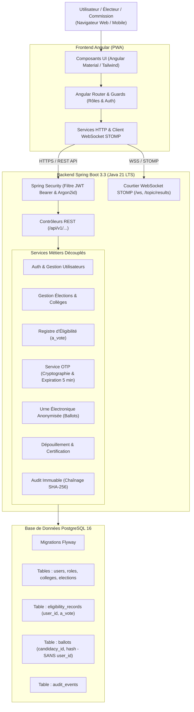
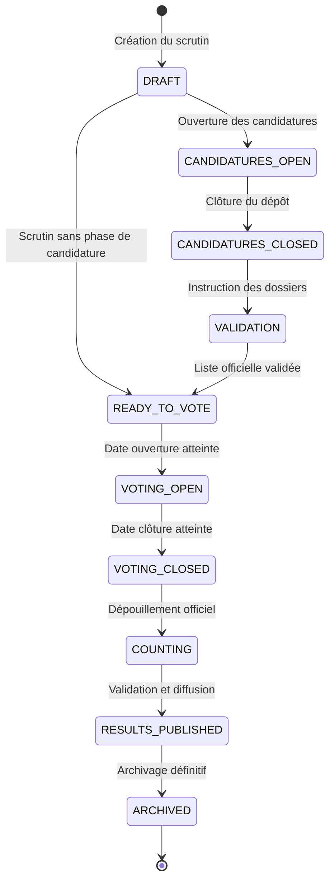

# Architecture Globale de VoteUASZ

## 1. Présentation Générale

**VoteUASZ** est la plateforme officielle de gestion et de déroulement des élections universitaires pour l'**Université Assane Seck de Ziguinchor (UASZ)** au Sénégal.

L'application est structurée selon une architecture monorepo moderne séparant rigoureusement le frontend web réactif (Angular) et le backend d'API sécurisé (Spring Boot) adossé à un SGBD relationnel robuste (PostgreSQL).

## 2. Découplage Strict et Secret du Scrutin

L'exigence fondamentale de VoteUASZ est d'empêcher tout double vote tout en rendant mathématiquement et structurellement impossible de relier l'identité d'un électeur à son vote :

1. **Phase 1 : Identification & Éligibilité**
   - L'électeur s'authentifie par email et mot de passe (haché en Argon2id).
   - Le système vérifie son éligibilité dynamique dans le scrutin selon son collège (`UFR`, `département`, `catégorie`).
   - Un code OTP aléatoire de 6 chiffres est généré, haché en SHA-256 et stocké pour une durée maximale de 5 minutes.

2. **Phase 2 : Consommation du Droit de Vote & Délivrance du Jeton Anonyme**
   - L'électeur saisit son code OTP.
   - Le service d'éligibilité met à jour de façon **atomique** le registre électoral (`UPDATE eligibility_records SET a_vote = true WHERE user_id = ? AND a_vote = false`). Si la requête ne modifie aucune ligne (tentative concurrente), le vote est rejeté.
   - Un **jeton d'autorisation de vote anonyme** (`VoteCredential`) à usage unique (valable 15 minutes) est généré cryptographiquement et remis au client.

3. **Phase 3 : Dépôt du Bulletin dans l'Urne (Anonymat Total)**
   - L'électeur transmet son bulletin accompagné de son jeton anonyme.
   - Le jeton est consommé de manière atomique (`utilise = true`).
   - Le bulletin est inséré dans la table `ballots`. **Cette table ne possède AUCUNE clé étrangère ni colonne liée aux utilisateurs**.
   - Un reçu cryptographique SHA-256 (`recu_vote_hash`) est délivré à l'électeur pour lui permettre de vérifier publiquement la présence de son bulletin dans l'urne sans révéler son choix.

## 3. Machine à États du Scrutin

Chaque élection traverse un cycle de vie contrôlé strictement côté serveur :

## 4. Spécifications Techniques

- **Langage Backend** : Java 21 LTS
- **Framework** : Spring Boot 3.3.5
- **Sécurité** : Spring Security 6, JJWT 0.12.6, Argon2id (Bouncy Castle)
- **Base de données** : PostgreSQL 16 & Flyway 10
- **Documentation API** : OpenAPI 3.0 / Swagger UI
- **Génération de Rapports** : OpenPDF 2.0
- **Temps Réel** : Spring WebSocket & STOMP Broker
- **Frontend** : Angular 19/21, Angular Material, TypeScript, PWA Service Worker
