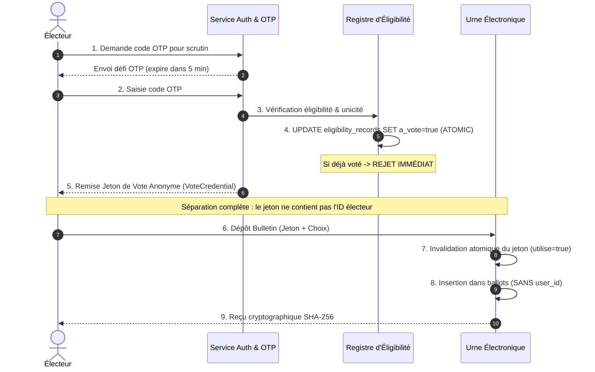

# Sécurité et Cryptographie dans VoteUASZ

## 1. Principes Fondamentaux de Cybersécurité

VoteUASZ répond aux critères stricts requis pour un système de vote électronique académique :
- **Authenticité** : Seuls les membres légitimes de la communauté UASZ (étudiants, enseignants, PAT) inscrits sur les listes électorales peuvent participer.
- **Unicité (Anti-Double Vote)** : Chaque électeur éligible ne peut voter qu'une seule et unique fois.
- **Secret du Scrutin (Anonymat)** : Aucun tiers, ni même l'administrateur système ou la commission électorale, ne peut relier l'identité d'un électeur au candidat pour lequel il a voté.
- **Intégrité de l'Urne** : Les bulletins scellés ne peuvent être altérés, supprimés ou falsifiés.
- **Vérifiabilité Individuelle** : Chaque électeur reçoit un reçu cryptographique lui permettant d'attester que son bulletin a bien été déposé dans l'urne.
- **Auditabilité Immuable** : Les actions administratives font l'objet d'un journal avec chaînage cryptographique d'intégrité (Hash-chaining).

---

## 2. Authentification et Mots de Passe

### Algorithme Argon2id
Conformément aux meilleures recommandations de l'OWASP et du cahier des charges :
- Utilisation de l'algorithme vainqueur de la Password Hashing Competition : **Argon2id** (via Bouncy Castle et Spring Security Crypto).
- Résistance matérielle prouvée contre les attaques par GPU et FPGA.

### Jetons JWT (JSON Web Tokens)
- Signés au moyen de **HMAC-SHA256** avec une clé d'entropie minimale de 256 bits.
- Durée de vie courte des jetons d'accès : 15 minutes (`900000 ms`).
- Jetons de rafraîchissement (`Refresh Tokens`) de 24 heures pour le renouvellement contrôlé.
- Révocation et expiration strictes côté serveur.

---

## 3. Mécanisme OTP (One-Time Password)

- Code aléatoire de 6 chiffres généré à partir d'un générateur pseudo-aléatoire cryptographiquement fort (`SecureRandom`).
- **Hachage en SHA-256 avant stockage** : le code OTP n'est **jamais stocké en clair** dans la base de données.
- **Durée de validité** : 5 minutes (300 secondes).
- **Consommation unique** : dès qu'un code est vérifié avec succès, il est marqué comme consommé et ne peut plus jamais être réutilisé.
- **Limitation des tentatives** : blocage après 3 échecs consécutifs.
- **Protection anti-inondation (Cooldown)** : temporisation de 60 secondes entre deux demandes successives.
- **Protection des logs** : le code en clair n'apparaît dans aucun journal de traces.

---

## 4. Protocole Anti-Double Vote et Anonymat

Le système met en œuvre un protocole en deux étapes à séparation de responsabilités :

---

## 5. Sécurité des Téléversements de Fichiers

Pour les dossiers de candidature (CV, attestations, affiches) :
- Vérification systématique de l'extension du fichier (`.pdf`, `.png`, `.jpg`).
- Contrôle strict du type MIME réel (`application/pdf`, `image/png`, `image/jpeg`).
- Renommage aléatoire avec des UUIDs pour empêcher les attaques par traversée de répertoire (`Path Traversal` type `../../`) et l'écrasement de fichiers.
- Répertoire de stockage externe hermétique à l'exécution de code serveur (pas d'exécution PHP/CGI/Script).
- Taille maximale plafonnée à 10 Mo.

---

## 6. Registre d'Audit et Chaînage Cryptographique

Les événements administratifs et système sont scellés dans la table `audit_events`.
Chaque événement calcule son empreinte d'intégrité en incluant l'empreinte de l'événement précédent :
$$\text{Empreinte}_n = \text{SHA-256}(\text{Empreinte}_{n-1} \parallel \text{UUID}_n \parallel \text{Type} \parallel \text{Acteur} \parallel \text{Horodatage})$$

Toute modification manuelle ou injection directe dans la base de données briserait la chaîne d'intégrité mathématique.
